# Lab 07 — Weather Advisor Infrastructure as Code with Terraform

**Course:** ITMO 444/544 — Cloud Computing Technologies  
**Lab:** Terraform Weather Advisor  
**Platform:** AWS  
**Region:** us-east-2 (Ohio)  
**Tools:** Terraform, AWS CLI, PowerShell, Node.js, DynamoDB, Google Gemini API  
**Status:** Completed — Infrastructure successfully destroyed

---

## 1. Objective

The purpose of this lab was to rebuild the Weather Advisor infrastructure using Terraform instead of the imperative Bash/Python deployment approach from the previous lab.

The lab demonstrates:

- Infrastructure as Code (IaC) and declarative configuration
- Terraform initialization, planning, application, and destruction
- Terraform state, dependency graphs, and idempotence
- EC2 Auto Scaling, launch templates, and Application Load Balancers
- Infrastructure drift detection and repair
- IAM least-privilege access
- Secure handling of API keys using AWS Systems Manager
- Graceful fallback when an AI service fails
- EC2 versus AWS Lambda architectural tradeoffs

All infrastructure was deployed in `us-east-2`.

---

## 2. Terraform and AWS Setup

Terraform was installed and verified using:

```powershell
terraform version
aws sts get-caller-identity
```

The AWS CLI successfully authenticated with the configured AWS account.

### Evidence

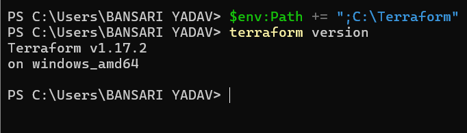

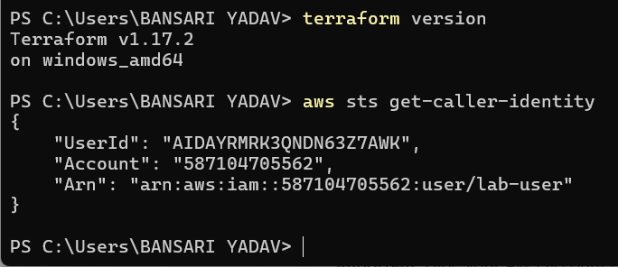

---

## 3. Part A — First Terraform Experiment

A small DynamoDB resource was created to understand the basic Terraform lifecycle.

The commands used were:

```powershell
terraform init
terraform plan
terraform apply
terraform destroy
```

### Initial creation

The first Terraform plan reported:

```text
Plan: 1 to add, 0 to change, 0 to destroy.
```

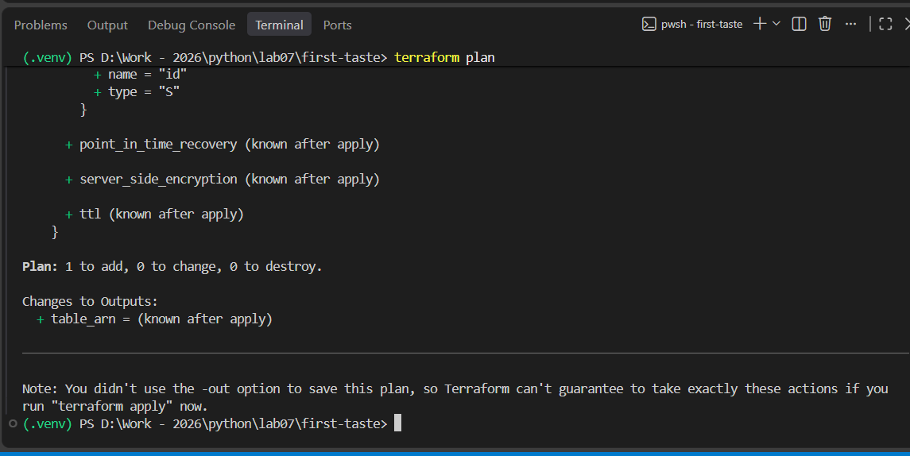

### Idempotence

Running Terraform again without changing the configuration returned:

```text
No changes. Your infrastructure matches the configuration.
```

This shows that Terraform does not recreate correctly configured resources.

### In-place update

Adding or changing a tag produced an in-place update, indicated by the `~` plan symbol.

### Replacement plan

Changing the DynamoDB primary key produced the `-/+` symbol, which indicates that the resource would be destroyed and recreated.

The replacement plan was examined but not applied because replacing an existing database could cause data loss.

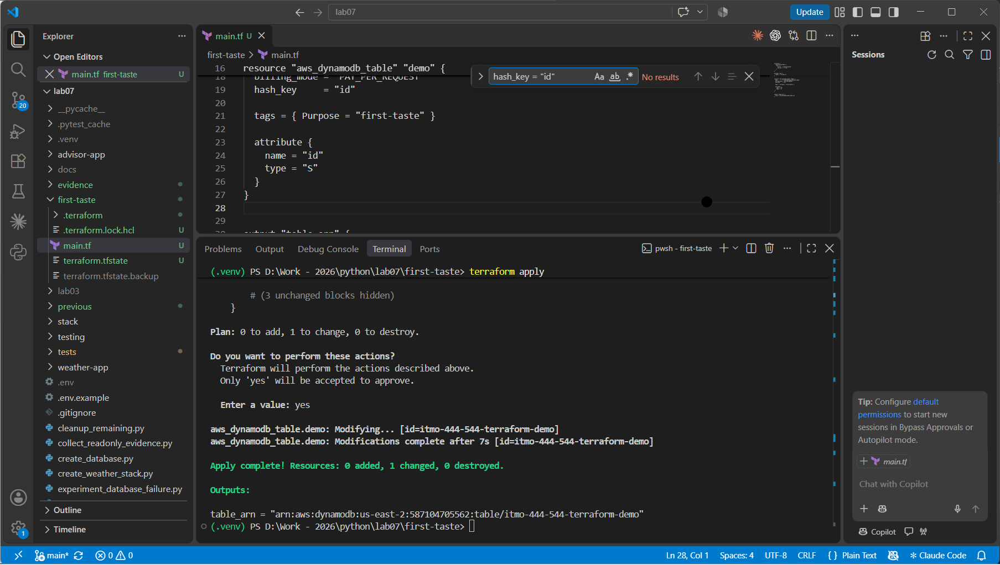

**Conclusion:** Terraform plans make infrastructure changes visible before execution. Replacement operations require particular care because they can affect availability and data.

---

## 4. Application Architecture

The deployed application consisted of two independently managed services.

### Weather Service

The Weather Service:

1. Accepts a US ZIP code.
2. Retrieves geographical information using Zippopotam.us.
3. Retrieves forecast data from the National Weather Service.
4. Stores weather information in DynamoDB.
5. Returns cached forecasts on repeated requests.

Example:

```http
GET /weather?zip=60616
```

### Advisor Service

The Advisor Service:

1. Accepts a ZIP code.
2. Retrieves the corresponding forecast from the Weather Service.
3. Obtains its Gemini API key from AWS Systems Manager Parameter Store.
4. Requests a clothing recommendation from Gemini.
5. Returns a local rule-based fallback when the Gemini request fails.

Example:

```http
GET /advice?zip=60616
```

### Infrastructure components

| Component | Responsibility |
|---|---|
| EC2 | Runs the Node.js applications |
| Auto Scaling Groups | Maintain application instances |
| Launch Templates | Configure instance startup |
| Application Load Balancer | Routes requests |
| Weather listener | Port 8080 |
| Advisor listener | Port 8081 |
| Application server | Port 3000 |
| DynamoDB | Weather forecast cache |
| IAM | Service-specific permissions |
| SSM Parameter Store | Gemini API key storage |
| Terraform | Infrastructure lifecycle management |

The application tiers used separate Auto Scaling Groups and target groups.

---

## 5. Terraform Configuration and Deployment

The infrastructure was defined using Terraform configuration files, including:

- `versions.tf`
- `variables.tf`
- `locals.tf`
- `network.tf`
- `storage.tf`
- `iam.tf`
- `alb.tf`
- `compute.tf`
- `outputs.tf`
- `user-data.sh.tftpl`

Shared values and the two application tiers were managed using Terraform locals and `for_each`.

### Validation

The configuration was initialized and checked using:

```powershell
terraform init
terraform fmt
terraform validate
terraform plan
```

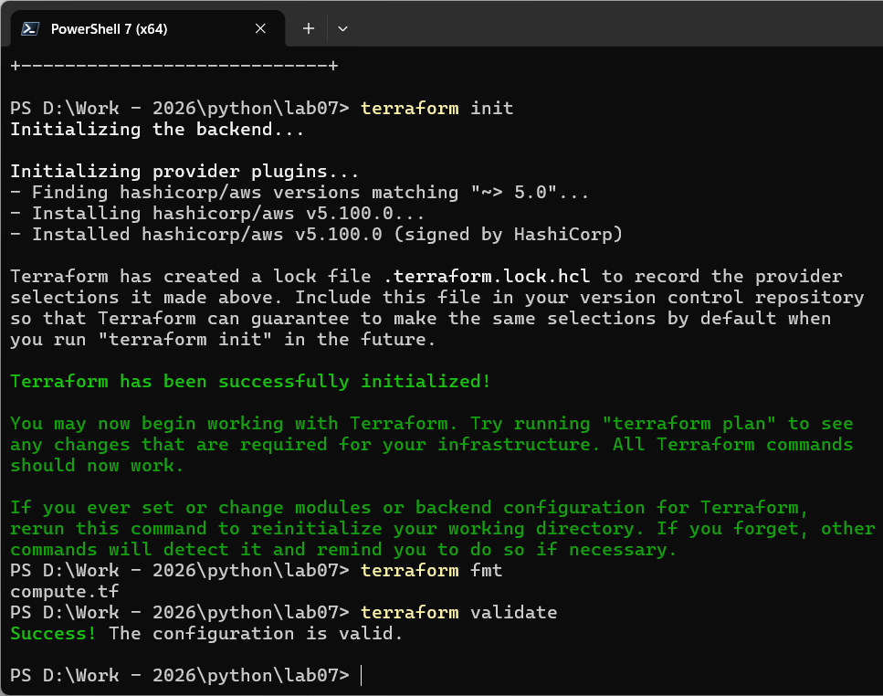

### Full-stack deployment

Terraform planned the creation of 25 managed AWS resources.

After applying the configuration, the two applications were deployed behind the ALB.

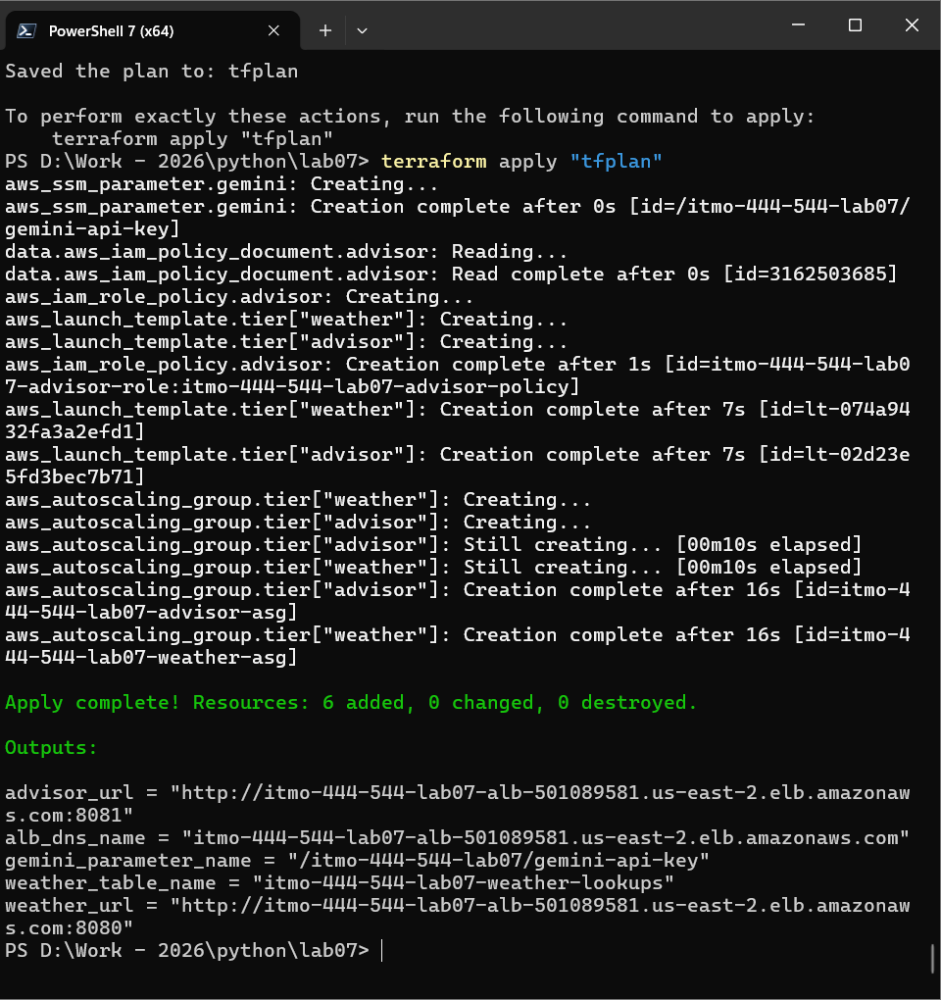

---

## 6. Application Testing

The deployed Weather and Advisor services were tested using AWS CLI, PowerShell, a browser, and the automated smoke test script.

### Weather cache

A repeated Weather API request returned a DynamoDB cache hit.

```text
cache: hit
```

### Advisor webpage

The Advisor webpage successfully displayed weather-based clothing recommendations generated by Gemini.

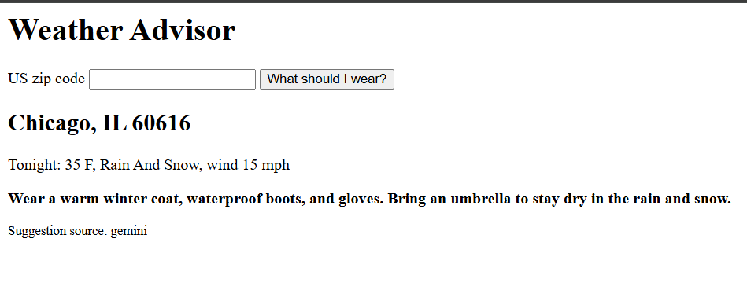

### Smoke tests

The Python smoke test verified the Weather API, caching, error handling, Advisor API, Gemini response, and webpage.

```powershell
python .\testing\app_smoke_test.py
```

**Result: 9 of 9 checks passed.**

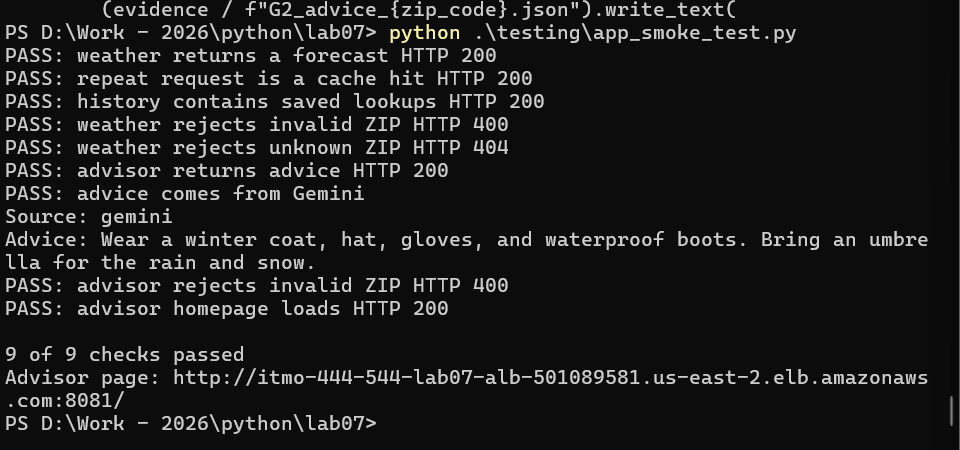

---

# 7. Terraform Experiments

## Experiment 1 — Imperative vs. Declarative Infrastructure

The original Bash/Python deployment approach was compared against the Terraform implementation.

The initial recorded counts were:

| Code group | Recorded lines |
|---|---:|
| Terraform `.tf` files | 338 |
| Previous Bash and Python scripts combined | 666 |

These are preliminary raw measurements. They are not a like-for-like comparison because the Terraform user-data template and the professor's separate Bash-only categories were not included consistently.

The final effort comparison should separately count:

| Required measurement | Value |
|---|---|
| Previous Bash-only code, excluding comments | To be measured |
| Terraform `.tf` and `user-data.sh.tftpl`, excluding comments | To be measured |
| Resource cleanup code | To be measured |
| Existence-check/helper code | To be measured |
| Wait/retry logic | To be measured |

### Analysis

In the previous implementation, resource creation order, existence checks, and cleanup required procedural scripts.

Terraform handled these responsibilities using declarative configuration, resource references, the state file, and its plan/apply workflow.

Terraform did not eliminate application bootstrapping, but it reduced infrastructure orchestration logic.

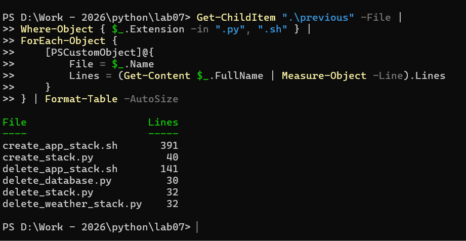

**Conclusion:** The main benefit of Terraform is repeatable management of infrastructure state, not simply a reduction in source-code lines.

---

## Experiment 2 — Dependency Graph

A Terraform dependency graph was generated using:

```powershell
terraform graph > terraform_graph.dot
dot -Tpng terraform_graph.dot -o terraform_graph.png
```

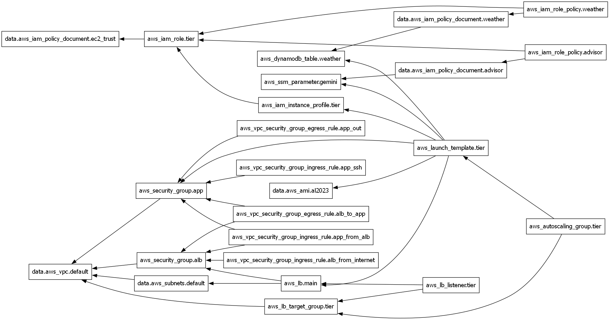

Terraform uses resource references to determine dependencies automatically.

For example, the Advisor configuration referenced the ALB DNS name to establish its Weather Service URL.

Removing such a reference could remove a dependency edge and change the resource creation order. If the application lost its correct Weather Service URL, forecast retrieval could fail.

**Conclusion:** Resource references help Terraform determine a safe infrastructure creation and update order.

---

## Experiment 3 — Idempotence

After deploying the stack, the following command was executed:

```powershell
terraform plan
```

Result:

```text
No changes. Your infrastructure matches the configuration.
```

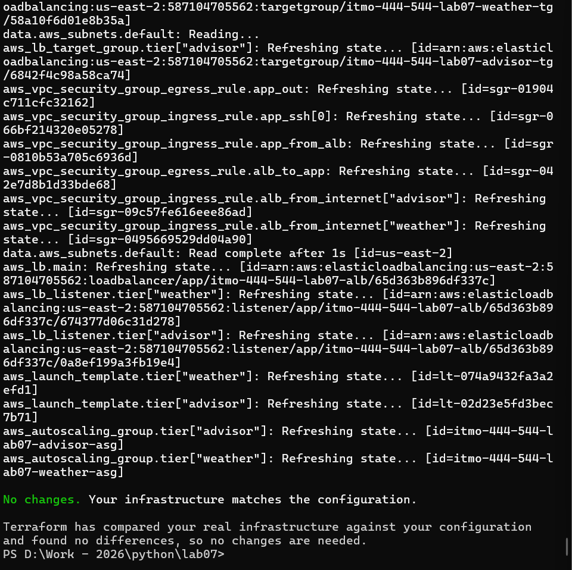

Unlike simple Bash existence checks, Terraform also compares managed resource attributes against the desired configuration.

**Conclusion:** Terraform produces a no-change plan when the deployed infrastructure matches its configuration.

---

## Experiment 4 — Configuration Update and Instance Refresh

The Weather Service cache duration was changed from 600 seconds to 60 seconds.

Terraform planned:

```text
Plan: 0 to add, 2 to change, 0 to destroy.
```

The changes affected the Weather launch template and Auto Scaling Group.

AWS Auto Scaling replaced the Weather instance using an instance refresh.

### Verification

The updated instance configuration showed:

```text
CACHE_SECONDS=60
```

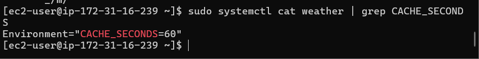

The original value was then restored:

```text
CACHE_SECONDS=600
```

The instance refresh completed successfully.

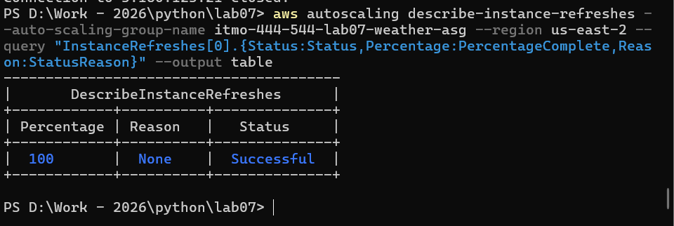

**Conclusion:** Terraform can manage application configuration changes through launch templates while AWS Auto Scaling manages instance replacement.

---

## Experiment 5 — Drift Detection and Recovery

Two manual changes were made outside Terraform.

### Test A — Health-check drift

The Weather target group's health-check path was changed from:

```text
/
```

to:

```text
/nope
```

Terraform detected the difference:

```text
Plan: 0 to add, 1 to change, 0 to destroy.
```

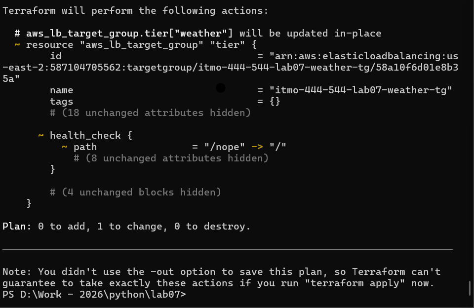

Running `terraform apply` restored the correct health-check path.

### Test B — Deleted Advisor listener

The Advisor listener on port 8081 was manually deleted from AWS.

Terraform detected the missing listener:

```text
Plan: 1 to add, 0 to change, 0 to destroy.
```

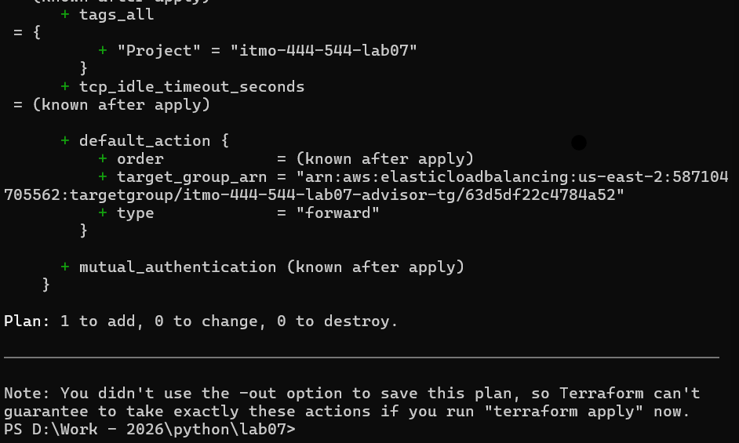

After applying the plan:

```text
Apply complete! Resources: 1 added, 0 changed, 0 destroyed.
```

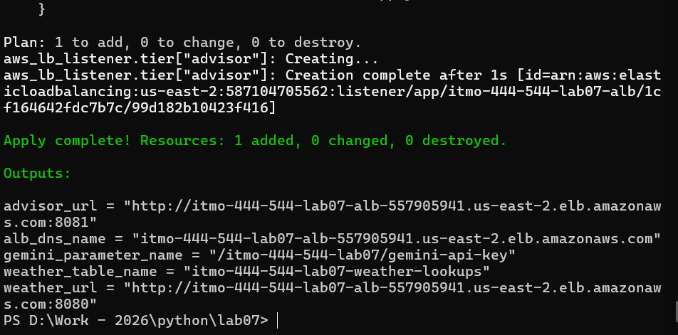

### Comparison with Bash

An imperative helper may only check whether a resource exists. Terraform can identify both missing resources and incorrect attributes.

**Conclusion:** Terraform detects infrastructure drift and can restore resources to the desired state.

---

## Experiment 6 — IAM Least Privilege

The AWS IAM Policy Simulator was used to test permissions for the Weather and Advisor roles.

| IAM role | Operation | Result |
|---|---|---|
| Weather | `dynamodb:GetItem` | Allowed |
| Advisor | `dynamodb:GetItem` | Implicit deny |
| Advisor | `ssm:GetParameter` | Allowed |
| Weather | `ssm:GetParameter` | Implicit deny |

The Weather tier had permission to access the weather cache, while the Advisor tier had permission to access the Gemini API key.

Each role was denied access to resources unnecessary for its responsibilities.

### Evidence

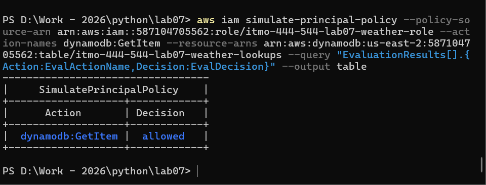

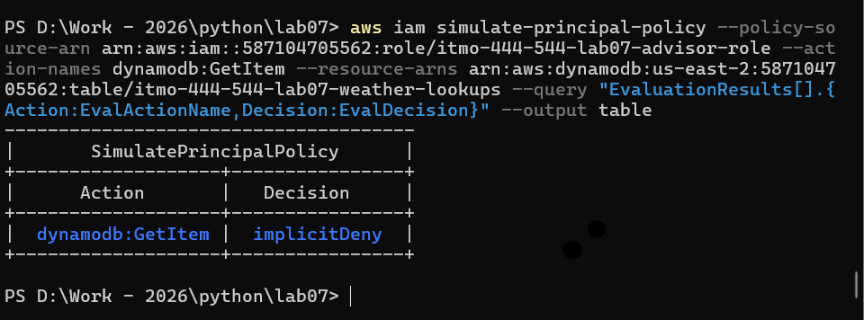

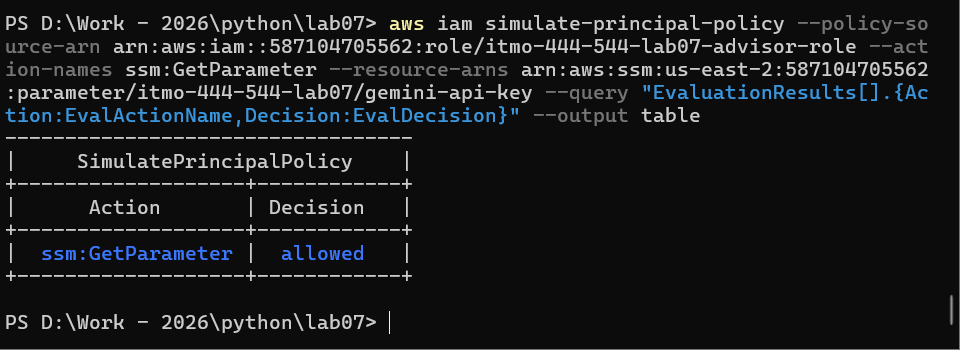

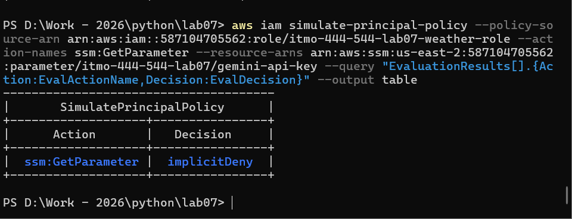

### Security analysis

If the Advisor tier were compromised, its IAM role would not provide the same DynamoDB permissions as the Weather role.

Separating service roles reduces the potential impact of a compromise.

**Conclusion:** IAM least privilege limits each application tier to the permissions needed for its work.

---

## Experiment 7 — Protecting Secrets

The Gemini API key was stored in AWS Systems Manager Parameter Store as a `SecureString`.

The parameter name was:

```text
/itmo-444-544-lab07/gemini-api-key
```

Terraform created the parameter with a placeholder value, and the working key was uploaded separately.

The parameter resource used:

```hcl
lifecycle {
  ignore_changes = [value]
}
```

This prevented a later Terraform apply from resetting the working key to the placeholder.

A check of Terraform state returned:

```text
PASS: No Gemini-style API key found in Terraform state
```

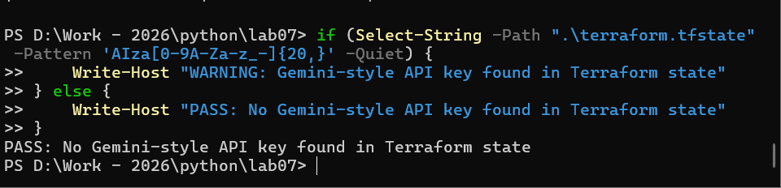

**Conclusion:** Sensitive application values should be managed separately from ordinary infrastructure configuration. Terraform state and saved plan files must still be protected because they can contain sensitive information.

---

## Experiment 8 — Gemini Failure and Fallback

The Advisor was tested with both a working and invalid Gemini API key.

### Normal operation

With a valid Gemini key, the Advisor returned:

```text
source: gemini
```

### Failure simulation

After replacing the API key with an invalid value, the Advisor returned a rule-based fallback recommendation.

```text
source: fallback
```

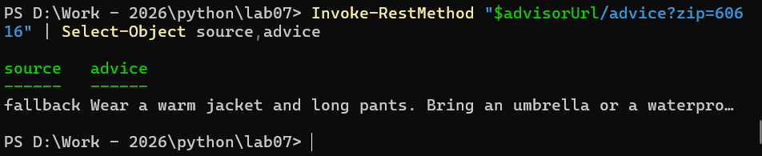

### Error log verification

The EC2 journal was inspected using:

```bash
sudo journalctl -u advisor --no-pager | grep gemini_error | tail -3
```

The observed log contained:

```json
{
  "event": "gemini_error",
  "zip": "60616",
  "status": 400,
  "reason": "gemini_http_error"
}
```

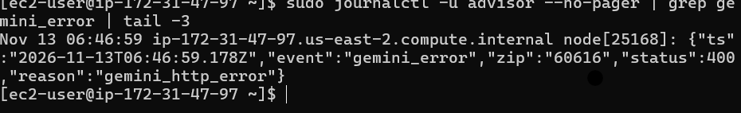

The valid Gemini key was restored during the original deployment, and the application returned to the `gemini` recommendation source.

### Why silent fallback is risky

The Advisor can remain functional even when Gemini is unavailable. This improves user experience but may hide persistent external service failures.

A production implementation should monitor API errors, fallback frequency, and application logs.

**Conclusion:** Graceful fallback improves availability, while logging and monitoring make failures visible to operators.

---

## Experiment 9 — Advisor on EC2 vs. AWS Lambda

This experiment evaluates migrating only the Advisor Service from EC2 to AWS Lambda. It is an architectural comparison; no Lambda deployment was performed.

| Current EC2 approach | Lambda-based alternative | What changes |
|---|---|---|
| Launch template and user-data | Lambda function and deployment package | Removes Advisor VM bootstrapping |
| Auto Scaling Group and instance refresh | Lambda-managed scaling | Removes Advisor EC2 instance lifecycle management |
| Security group access to application port 3000 | Lambda target behind ALB | Removes Advisor instance ingress-port requirement |
| EC2 instance profile and role | Lambda execution role | Changes IAM service trust and execution identity |
| Node.js installation and systemd service | Managed Lambda runtime | Removes manual server runtime installation and service startup |
| EC2 target health checks and grace period | Lambda target group and invocation monitoring | Changes how application health and failures are observed |

### What Terraform would still manage

Terraform would still manage:

- Application Load Balancer and listeners
- Weather Service EC2 infrastructure
- DynamoDB
- SSM Parameter Store
- IAM roles and permissions
- Lambda function configuration
- ALB-to-Lambda invocation permissions

### Additional implementation requirements

The Advisor application would need to accept Lambda events and return the response format expected by an ALB Lambda target.

Terraform would also need:

- An `aws_lambda_function` resource
- Lambda deployment packaging
- A Lambda-compatible target group
- Lambda invocation permissions
- A Lambda execution role

### Tradeoffs

**Benefits:** Less server maintenance, automatic scaling, and potentially lower cost for intermittent traffic.

**Limitations:** Cold starts, runtime limits, packaging changes, and a different event/request model.

**Conclusion:** Terraform and Lambda solve different problems. Terraform manages infrastructure, while Lambda runs application code without requiring direct EC2 management.

---

## Experiment 10 — Destroy and Cleanup

After completing the experiments, the infrastructure was removed.

```powershell
terraform destroy
```

The final cleanup completed with:

```text
Destroy complete! Resources: 25 destroyed.
```

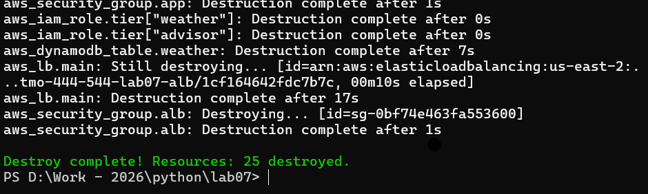

### Verification

The following command returned no managed resources:

```powershell
terraform state list
```

AWS CLI checks confirmed that no Lab 07 security groups or security group rules matching the project's tags remained.

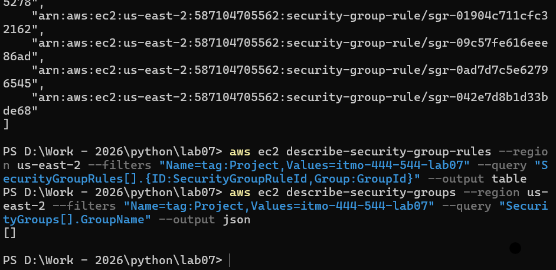

The earlier deployment had also been destroyed successfully. A temporary second deployment was used to complete the missing listener recovery and Gemini error-log evidence, and this second deployment was destroyed afterward.

### Estimated cost

The assignment uses an estimated infrastructure rate of approximately **$0.07 per hour**.

```text
Estimated AWS cost = Total running hours × $0.07
```

The total running time should include both deployment periods.

| Measurement | Value |
|---|---|
| First deployment duration | Not established from available screenshots |
| Second deployment duration | Not established from available screenshots |
| Total running time | Requires actual timing or billing data |
| Estimated hourly rate | $0.07/hour |
| Estimated total | Pending actual running hours |

The hourly estimate is for the lab calculation; actual billing can differ because of usage, pricing, storage, and other applicable AWS charges.

The infrastructure was successfully destroyed and its cleanup verified.

---

# 8. Review Questions — Section 13.1

## Q1. Declarative vs. imperative infrastructure

Bash allows custom procedural operations and detailed step-by-step control. Terraform automatically detects differences between desired and actual infrastructure and produces a plan to correct them. This eliminates the need to write many custom resource comparison and reconciliation functions.

## Q2. Terraform state

If state is lost, Terraform can lose track of existing resource identifiers and may attempt to recreate infrastructure. Two users working from separate state copies can produce conflicting changes. Teams use shared remote state, access controls, locking, and controlled deployment workflows to prevent these problems.

## Q3. Secrets in Terraform state

Secrets can enter state through resource attributes, variables, data sources, or provider-returned values. Marking output as sensitive does not necessarily remove it from state or saved plans. State and plan files should be treated as sensitive artifacts.

## Q4. Why inspect a Terraform plan?

A plan reveals proposed additions, modifications, removals, and replacements. The `-/+` symbol deserves particular attention because it indicates destruction and recreation of an existing resource.

## Q5. Provider version pinning

Version pinning helps prevent untested provider upgrades from changing behavior or breaking configurations. `.terraform.lock.hcl` records selected provider versions and checksums, helping maintain consistent installations.

## Q6. Why use for_each instead of count?

`for_each` uses stable keys such as `weather` and `advisor`. Removing one named tier does not shift the identities of other resources. Numeric indexes from `count` may shift when items are removed.

## Q7. Manual changes to Terraform-managed resources

Manual changes create drift between the deployed infrastructure and the Terraform configuration. Subsequent Terraform applies may reverse these changes or reveal unexpected differences. Managed resources should normally be changed through Terraform.

## Q8. Automatic drift detection

Teams can run scheduled Terraform plans in CI/CD systems and alert operators when a plan detects unexpected differences. Manual production changes should be restricted to authorized personnel and documented when necessary.

## Q9. Infrastructure blast radius

The blast radius depends on shared infrastructure, dependency relationships, and how resources are grouped into Terraform configurations and state. In this lab, a Weather cache-setting update affected the Weather launch template and Auto Scaling Group rather than rebuilding the entire application.

Separating environments and independent services can reduce the impact of changes.

## Q10. Why reference resource ARNs?

Referencing a managed resource ARN avoids typing account numbers, names, regions, or identifiers manually. It also establishes a relationship between the resource and the IAM policy, improving configuration consistency.

## Q11. Terraform compared with Lambda

Terraform manages cloud infrastructure through declarative configuration. Lambda executes application functions without requiring users to manage application servers directly.

Both reduce operational work, but they operate at different layers.

## Q12. Preventing accidental destruction

Production databases, critical storage, and other important resources may require protection against accidental removal.

Terraform supports:

```hcl
lifecycle {
  prevent_destroy = true
}
```

This prevents Terraform from planning destruction while that protection remains in the configuration.

Production safeguards should also include backups, access control, reviews, and recovery procedures.

---

# 9. Terraform Limitations and Lessons Learned

Although Terraform simplified resource management, the lab still required troubleshooting of application startup, IAM permissions, user-data scripts, and external API responses.

Terraform also introduced responsibilities related to state management, provider compatibility, and review of potentially destructive plans.

Important lessons included:

1. Use plans to inspect changes before applying them.
2. Prefer reusable resource definitions over duplicated configuration.
3. Keep API keys and credentials out of source control.
4. Apply least-privilege permissions to independent services.
5. Monitor external service failures even when fallback responses work.
6. Verify actual AWS resources after running `terraform destroy`.

---

# 10. Final Submission Checklist

| Requirement | Status |
|---|---|
| Terraform and AWS setup evidence | Included |
| Part A creation, idempotence, update, replacement | Explained; selected evidence included |
| Terraform validation and full deployment | Included |
| Application webpage and nine smoke tests | Included |
| Experiments 1–3 | Included; exact effort-count table still needs final measurement |
| Experiments 4–5 | Included |
| Experiments 6–7 | Included; verify whether an additional `dynamodb:PutItem` simulation is required |
| Experiments 8–9 | Included |
| Review questions | Included |
| Destroy and cleanup | Included; actual cost calculation still needs deployment duration |

Before submission:

- Verify that all Markdown images render in VS Code.
- Verify that no screenshots reveal API keys.
- Mask AWS account numbers wherever required by the assignment.
- Confirm the final effort-count table and actual running hours.
- Include the Terraform source code and any other deliverables required by the professor.

---

# 11. Conclusion

Lab 07 successfully demonstrated the Terraform lifecycle for an AWS-hosted Weather Advisor application.

The infrastructure was deployed with EC2, Auto Scaling Groups, an Application Load Balancer, DynamoDB, IAM roles, and Systems Manager Parameter Store.

Both application tiers were tested successfully, with all nine smoke tests passing.

The experiments demonstrated idempotence, dependency management, configuration updates, drift recovery, IAM least privilege, secret protection, AI service fallback, and infrastructure cleanup.

Terraform successfully recreated a deleted Advisor listener and restored a manually changed target group configuration.

The final infrastructure was destroyed successfully, and AWS cleanup was verified.

**Overall, the lab showed how Infrastructure as Code makes cloud infrastructure more repeatable, auditable, recoverable, and manageable than manual resource orchestration.**

---

## References

- [Terraform Documentation](https://developer.hashicorp.com/terraform/docs)
- [Terraform AWS Provider](https://registry.terraform.io/providers/hashicorp/aws/latest/docs)
- [AWS EC2 Auto Scaling](https://docs.aws.amazon.com/autoscaling/ec2/userguide/what-is-amazon-ec2-auto-scaling.html)
- [AWS Lambda](https://docs.aws.amazon.com/lambda/latest/dg/welcome.html)
- [AWS IAM Policy Simulator](https://docs.aws.amazon.com/IAM/latest/UserGuide/access_policies_testing-policies.html)
- [AWS Systems Manager Parameter Store](https://docs.aws.amazon.com/systems-manager/latest/userguide/systems-manager-parameter-store.html)
- [National Weather Service API](https://www.weather.gov/documentation/services-web-api)
- [Google Gemini API](https://ai.google.dev/gemini-api/docs)
